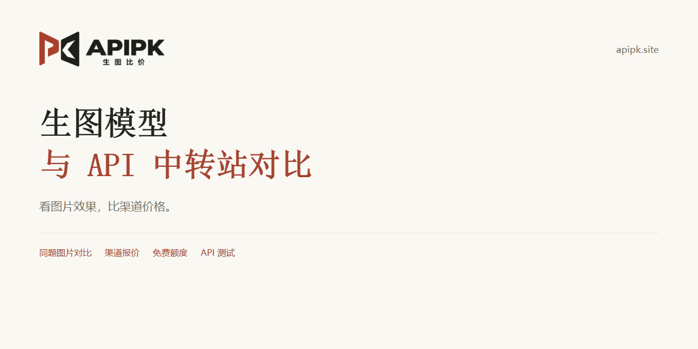
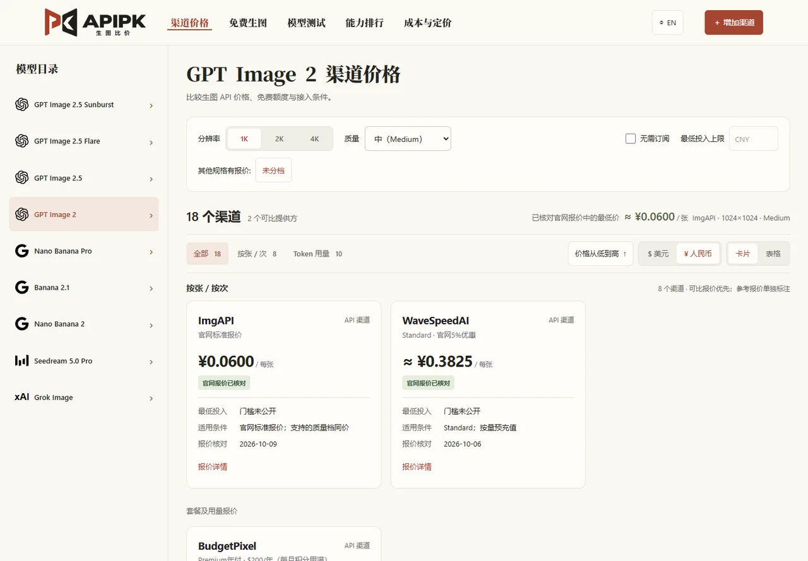
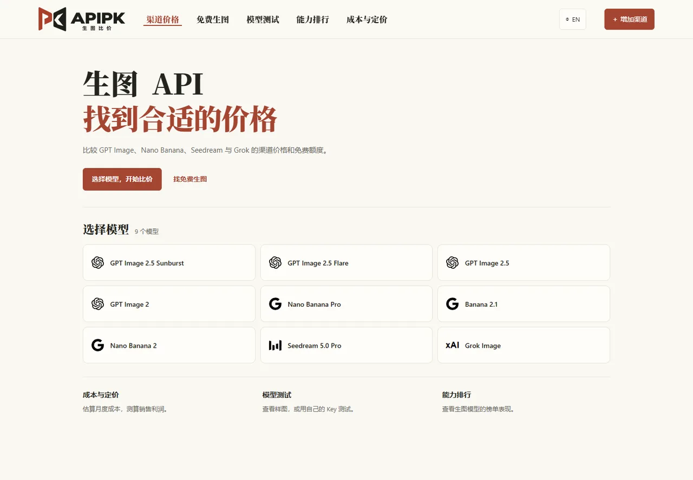

# APIpk · 生图模型与图片 API 中转站对比

按相同规格查生图 API 价格，用同一提示词直观看不同模型的图片效果。收录 GPT Image、Nano Banana、Seedream、Grok 等型号的渠道报价、免费入口和使用指南。

[访问网站](https://apipk.site) · [模型图片对比](https://apipk.site/model-test) · [免费生图入口](https://apipk.site/free-channels) · [比较方法](docs/methodology.md) · [最近变更](docs/changelog.md)

## 从你的需求开始

| 想解决什么 | 去哪里看 |
| --- | --- |
| 直观看模型生成效果 | [图片矩阵](https://apipk.site/model-test) / [逐张样图与完整提示词](docs/samples.md) |
| 比较同型号、同尺寸的渠道报价 | 下方价格摘要 / [全部模型](docs/models.md) / [渠道索引](docs/providers.md) |
| 找免费额度，区分网页与 API | [免费规则与资格](docs/free-channels.md) / [网站筛选](https://apipk.site/free-channels) |
| 检查自己的 Key 能否调用 | [API 测试页](https://apipk.site/model-test)，由所选渠道计费 |
| 选择 Nano Banana 或了解接入 | [使用指南](docs/guides.md) |

## 同规格价格摘要

按网站默认场景展示每个型号的部分官网报价，渠道按标识排序；这不是最低价榜或推荐排名。规格、套餐条件和其他渠道请打开模型详情，质量未指定的报价不外推到特定质量档。

| 型号 | 默认规格 | 已核对报价示例 · 核对日期 |
| --- | --- | --- |
| [Nano Banana 2](docs/models/nano-banana-2.md) | 文生图 · 1K · 1 张 | AtlasCloud · Developer：$0.028 / 张（2026-10-05，[来源](<https://www.atlascloud.ai/zh/pricing/models?type=image>)） fal.ai · Standard：$0.08 / 张（2026-09-29，[来源](<https://fal.ai/models/fal-ai/nano-banana-2>)） |
| [Nano Banana Pro](docs/models/nano-banana-pro.md) | 文生图 · 1K · 1 张 | AtlasCloud · Developer：$0.049 / 张（2026-10-05，[来源](<https://www.atlascloud.ai/zh/pricing/models?type=image>)） fal.ai · Standard：$0.15 / 张（2026-09-29，[来源](<https://fal.ai/models/fal-ai/nano-banana-pro>)） |
| [GPT Image 2](docs/models/gpt-image-2.md) | 文生图 · 1024×1024 · Medium | ImgAPI · 官网标准报价：¥0.06 / 张（2026-10-09，[来源](<https://imgapi.vip/models>)） WaveSpeedAI · Standard · 官网5%优惠：$0.057 / 张（2026-10-06，[来源](<https://wavespeed.ai/pricing>)） |
| [GPT Image 2.5 Sunburst](docs/models/gpt-image-2.5-sunburst.md) | 1K · medium | BudgetPixel · 充值包 · $10 / 10,000 积分（无需订阅）：$0.04 / 张（2026-10-05，[来源](<https://docs.budgetpixel.com/api-reference/openai/generate-image-with-gpt-image-25-sunburst>)） ImgAPI · 默认渠道 · 按张计费：¥0.12 / 张（2026-10-09，[来源](<https://imgapi.vip/models>)） |
| [GPT Image 2.5 Flare](docs/models/gpt-image-2.5-flare.md) | 1K · 画质未指定 | GetAPI · GPT稳定分组：¥0.16 / 张（2026-10-06，[来源](<https://www.getapi.one/pricing>)） ImgAPI · 官网标准报价：¥0.1 / 张（2026-10-09，[来源](<https://imgapi.vip/models>)） |
| [GPT Image 2.5](docs/models/gpt-image-2.5.md) | 1K | Grsai · 最低充值档 · ¥10：¥0.06 / 张（2026-10-06，[来源](<https://grsai.com/zh/dashboard/models>)） ImgAPI · 默认渠道 · 按张计费：¥0.03 / 张（2026-10-09，[来源](<https://imgapi.vip/models>)） |
| [Banana 2.1](docs/models/nano-banana-2.1.md) | 1K | fal.ai · 官网标准报价：$0.08 / 张（2026-10-08，[来源](<https://fal.ai/nano-banana-2.1>)） Grsai · 标准 · ¥10充值档：¥0.12 / 张（2026-10-08，[来源](<https://grsai.com/zh/dashboard/models>)） |
| [Grok Image](docs/models/grok-image.md) | 默认规格 | AIMLAPI · 官网标准报价：$0.026 / 张（2026-10-06，[来源](<https://aimlapi.com/models/grok-imagine-image>)） Replicate · 官网标准报价：$0.02 / 张（2026-10-06，[来源](<https://replicate.com/xai/grok-imagine-image/readme>)） |
| [Seedream 5.0 Pro](docs/models/seedream-5.0-pro.md) | 1K | AtlasCloud · 官网价格页 · 标准生成：$0.036 / 张（2026-10-06，[来源](<https://www.atlascloud.ai/zh/pricing/models?type=image>)） ImgAPI · 官网标准报价：¥0.08 / 张（2026-10-08，[来源](<https://imgapi.vip/models>)） |

报价来自公开资料，不代表实际扣费或接口稳定性；按 Token、订阅套餐与缺少完整规格的资料不转换成固定单张价格。网页标价、免费资格和真实调用各自保留证据。

## 全模型生图效果对比

同一提示词，直观看不同模型的生成效果。

[在网站打开原图](https://apipk.site/model-test) · [查看逐张预览、提示词与来源](docs/samples.md)

## 当前收录范围

本快照有 **9 个生图型号分组、22 个报价渠道、759 条规格记录、30 个免费规则渠道**。图片为 **3 个场景 × 6 个展示型号，共 18 张**。

| 型号 | 报价渠道数 | 完整交互入口 |
| --- | --- | --- |
| [Nano Banana 2](docs/models/nano-banana-2.md) | 17 | [网站详情](https://apipk.site/models/nano-banana-2) |
| [Nano Banana Pro](docs/models/nano-banana-pro.md) | 17 | [网站详情](https://apipk.site/models/nano-banana-pro) |
| [GPT Image 2](docs/models/gpt-image-2.md) | 17 | [网站详情](https://apipk.site/models/gpt-image-2) |
| [GPT Image 2.5 Sunburst](docs/models/gpt-image-2.5-sunburst.md) | 18 | [网站详情](https://apipk.site/models/gpt-image-2.5-sunburst) |
| [GPT Image 2.5 Flare](docs/models/gpt-image-2.5-flare.md) | 17 | [网站详情](https://apipk.site/models/gpt-image-2.5-flare) |
| [GPT Image 2.5](docs/models/gpt-image-2.5.md) | 5 | [网站详情](https://apipk.site/models/gpt-image-2.5) |
| [Banana 2.1](docs/models/nano-banana-2.1.md) | 14 | [网站详情](https://apipk.site/models/nano-banana-2.1) |
| [Grok Image](docs/models/grok-image.md) | 7 | [网站详情](https://apipk.site/models/grok-image) |
| [Seedream 5.0 Pro](docs/models/seedream-5.0-pro.md) | 10 | [网站详情](https://apipk.site/models/seedream-5.0-pro) |

型号与质量档以记录为准；渠道自定义名称不自动等同于厂商独立型号。当前图片来自同一渠道的公开样图，尚无跨渠道重复生成批次、人工盲评胜率或 Elo 排名。

## 数据时间与更新

- 最近公开内容变更：2026-10-09。这是导出内容的变更时间。
- 报价核对日期范围：2026-09-29 至 2026-10-09；免费规则：2026-10-08；样图采集：2026-09-30。
- 最近变更内容：models、providers、quotes、free-channels、samples、exclusions。没有内容变化不会刷新测评日期。
- [数据快照与摘要](data/metadata.json) · [有效变更记录](docs/changelog.md) · [待核实与移出说明](docs/exclusions.md)。

公开资料由网站静态目录按字段清单导出，再生成本 README 和详情文档。已提供导出、生成和校验脚本；当前未配置每日来源采集或自动推送。

## 使用指南与参与完善

[Nano Banana 选型、免费入口与 API 接入](docs/guides.md) · [常见问题](docs/faq.md) · [比较方法](docs/methodology.md) · [关系披露](docs/disclosures.md)

通过 [Issue](https://github.com/shanyeai/image-api-pk/issues/new/choose) 补充渠道、纠正价格或报告待核实问题。请提供精确型号、规格、公开来源与日期，不提交 Key 或个人账单。[贡献说明](CONTRIBUTING.md)

维护者操作见[数据维护](docs/maintenance.md)。原创内容未授予开放复用许可证，第三方图片与数据保留各自来源和权利，见[版权说明](COPYRIGHT.md)。
