# 全模型生图效果对比

同一提示词，直观看不同模型的生成效果。

<table>
<tr><th>型号</th><th>花店</th><th>人像</th><th>电商</th></tr>
<tr><th>GPT Image2.5 标准版</th><td><a href="https://imgapi.vip/preview-assets/image25-standard-example.png?v=rainy-florist-v1">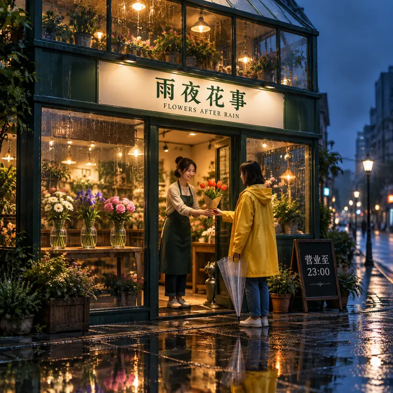</a></td><td></td><td><a href="https://imgapi.vip/preview-assets/gpt-image-2.5-ecommerce-bicycle-poster-v1.png">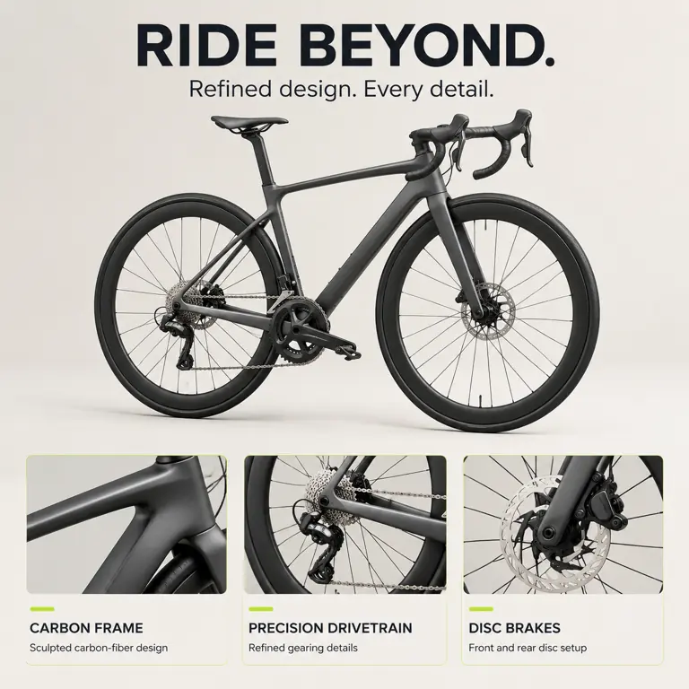</a></td></tr>
<tr><th>GPT Image2.5 Flare</th><td><a href="https://imgapi.vip/preview-assets/image25-flare-example.png?v=rainy-florist-v1">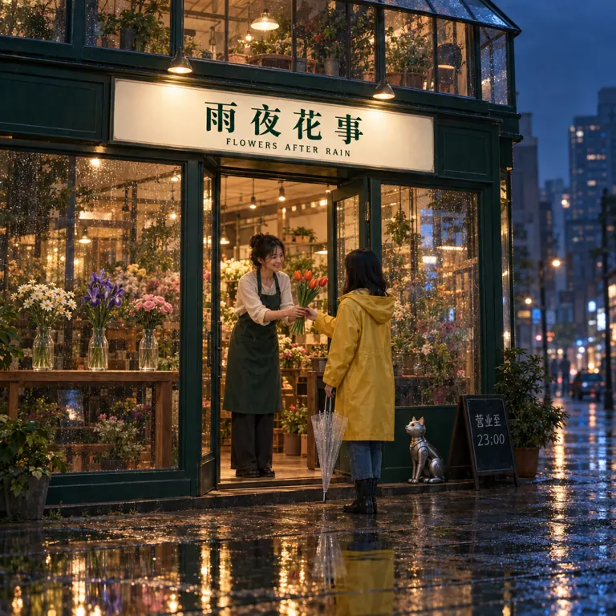</a></td><td></td><td><a href="https://imgapi.vip/preview-assets/gpt-image-2.5-flare-ecommerce-bicycle-poster-v1.png">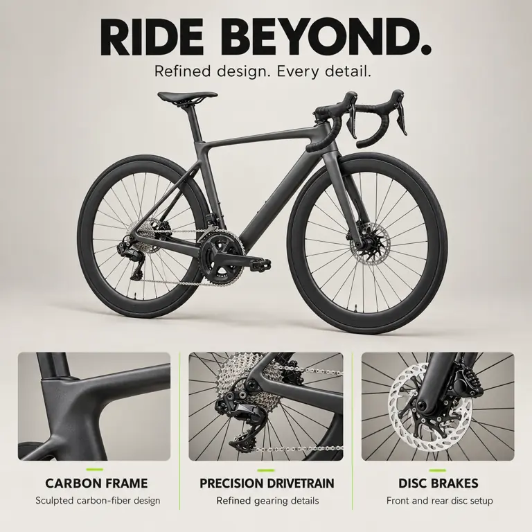</a></td></tr>
<tr><th>GPT Image2.5 Sunburst</th><td><a href="https://imgapi.vip/preview-assets/image25-sunburst-example.png?v=rainy-florist-v1">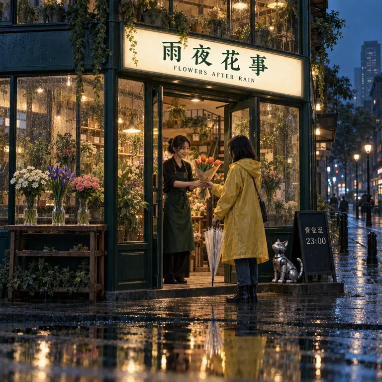</a></td><td></td><td><a href="https://imgapi.vip/preview-assets/gpt-image-2.5-sunburst-ecommerce-bicycle-poster-v1.png">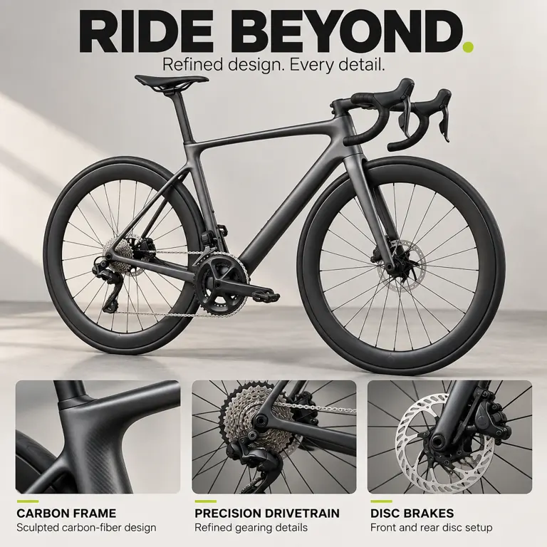</a></td></tr>
<tr><th>GPT Image 2</th><td><a href="https://imgapi.vip/preview-assets/image2-rainy-florist.png?v=rainy-florist-v1">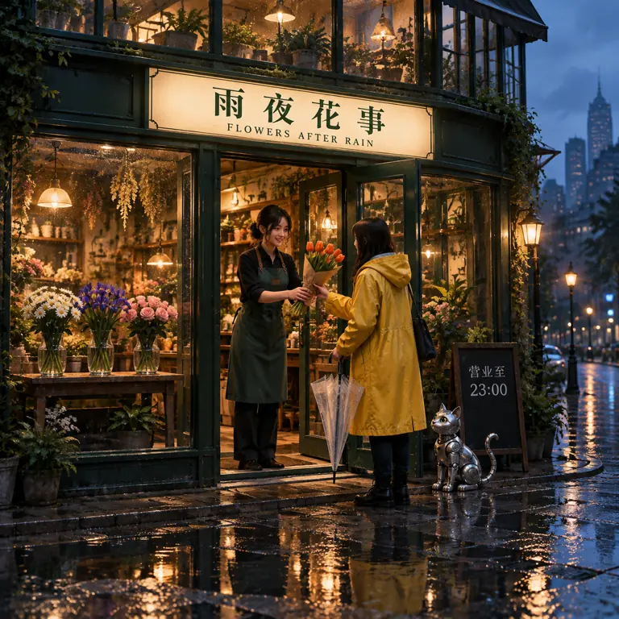</a></td><td></td><td><a href="https://imgapi.vip/preview-assets/gpt-image-2-ecommerce-bicycle-poster-v1.png">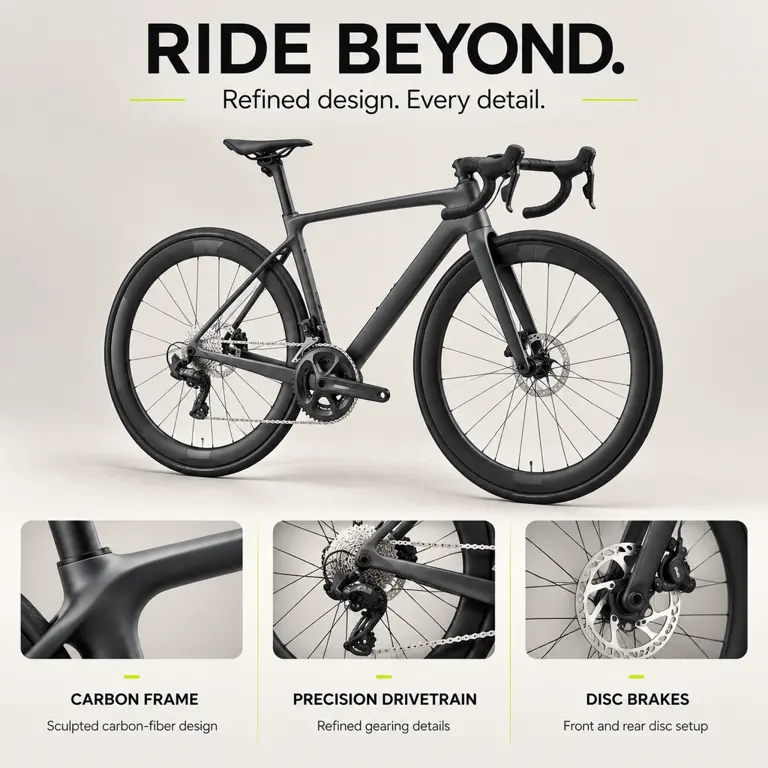</a></td></tr>
<tr><th>Banana Pro</th><td><a href="https://imgapi.vip/preview-assets/banana-pro-rainy-florist.png?v=rainy-florist-v1">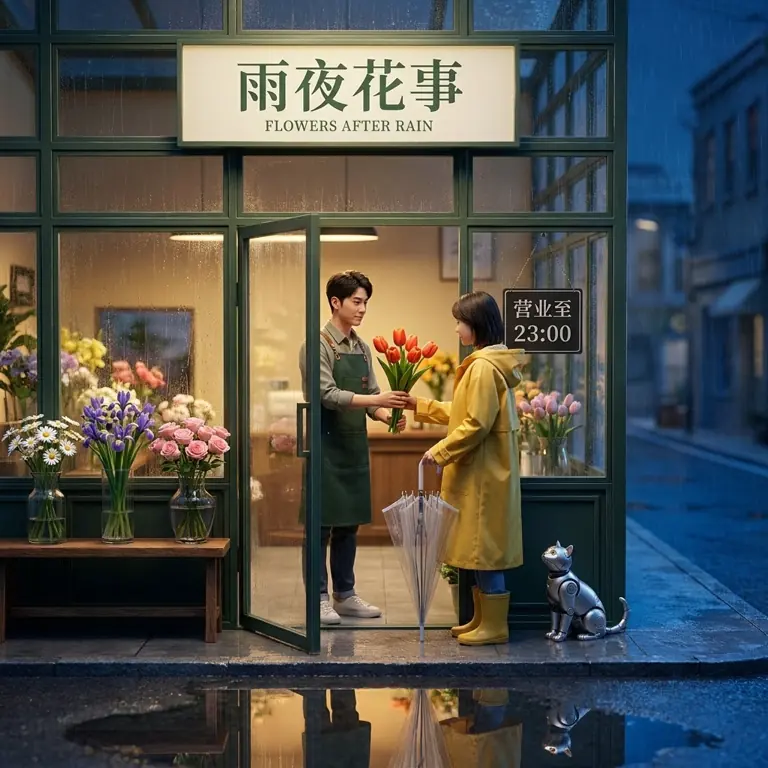</a></td><td></td><td><a href="https://imgapi.vip/preview-assets/nano-banana-pro-ecommerce-bicycle-poster-v1.png">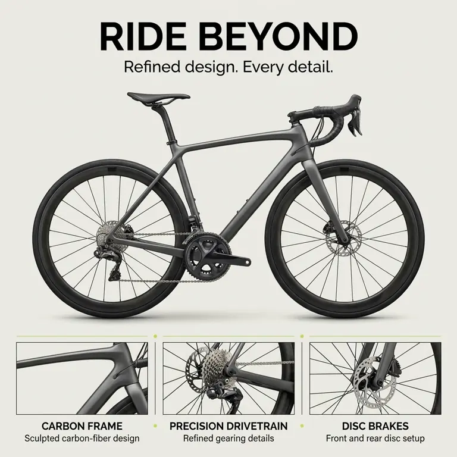</a></td></tr>
<tr><th>Banana 2</th><td><a href="https://imgapi.vip/preview-assets/banana2-rainy-florist.png?v=rainy-florist-v1">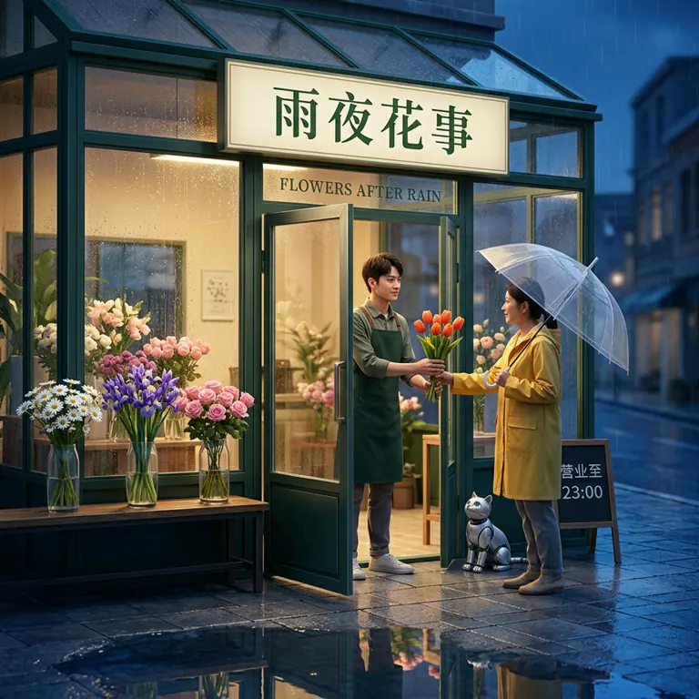</a></td><td></td><td><a href="https://imgapi.vip/preview-assets/nano-banana-2-ecommerce-bicycle-poster-v1.png">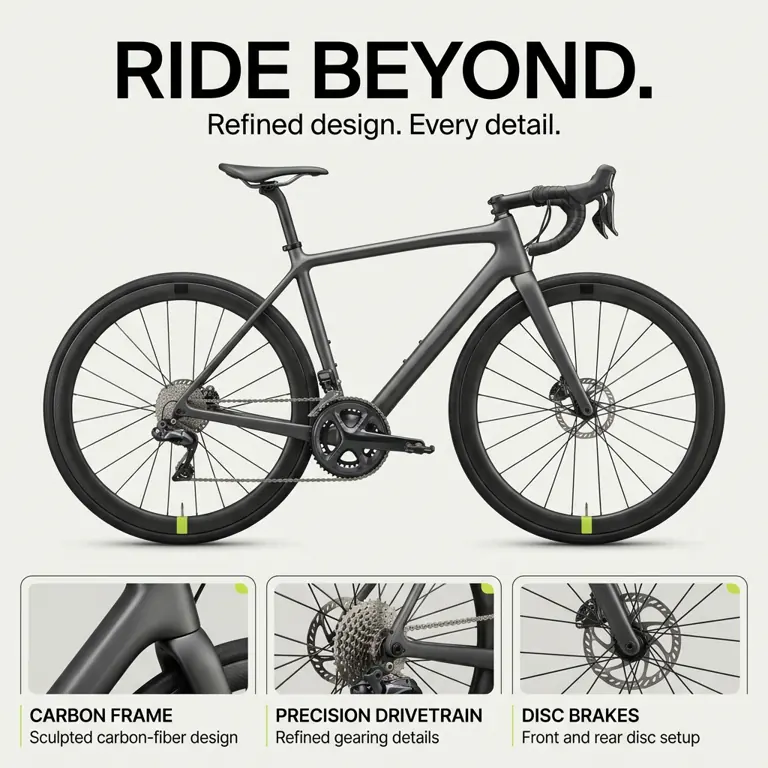</a></td></tr>
</table>

## 完整提示词

### 花店

创作一张 1:1 正方形的高端商业海报，主题是“雨夜未来花店”。画面融合电影级写实摄影与精密微缩场景，情绪温暖、安静、有故事感，不要卡通化，不要拼贴或分镜。

构图：平视略低机位，35mm 镜头感。一间两层高、墨绿色金属框架的玻璃花店占画面中央约三分之二，店面、屋顶与门口完整入镜。雨后的深蓝色街道延伸到右后方，远处建筑自然虚化；前景左下角是一小片清晰的积水。暖金色店内灯光与冷蓝色雨夜形成对比，画面层次分明，暗部仍保留细节。

文字设计：店铺正上方的奶油白色横向招牌，用清晰、规整的深绿色中文准确写出“雨夜花事”；招牌下方以较小的英文写出“FLOWERS AFTER RAIN”。右侧门边的黑色小立牌上清楚写出“营业至 23:00”。只出现这三处指定文字，字形完整，排版自然融入场景，不要乱码、额外标语、水印或其他商标。

主体与空间关系：店门打开，一位穿深绿色围裙的年轻成年花艺师站在门内，双手把一束恰好五枝、花头可分别辨认的橙红色郁金香递给门外穿黄色雨衣的成年顾客。顾客一手接花，另一手握着收拢的透明雨伞；人物手指、握持、递接动作和遮挡关系自然。门左侧的木架上从左到右排列三个透明玻璃花瓶，分别插着白色雏菊、紫色鸢尾和粉色玫瑰，三个花瓶不重叠。门右侧坐着一只银色小型机械猫，抬头看着花束，不要出现其他人物或动物。

细节与物理质感：玻璃橱窗有细密雨滴，同时能看见室内花朵与微弱的街景反射；金属门框有克制的拉丝质感和边缘高光，木架有真实木纹，雨衣有柔软折痕，透明伞面保留折叠层次。积水中应当对应反射招牌暖光、黄色雨衣和店门轮廓，方向与位置符合真实场景，不能像复制出另一间店。花瓣、玻璃、金属、布料和湿润石板的材质明显不同。

整体完成度：主体清晰，色彩高级但不过饱和，人物与店面比例可信，灯光和透视统一。保持文字可读与场景美感，不使用夸张光晕，不磨皮，不用杂乱细节填满画面。

### 人像

生成一张 1:1 正方形的写实人像摄影作品。人物是虚构的 32 岁东亚女性陶艺师，不模仿任何真实名人。像一本独立生活杂志中的环境肖像，安静、自然、有真实生活感，不能像广告精修照或 3D 渲染。

构图：相机位于人物眼睛高度，50mm 镜头感，半身近景，从头顶到腰部完整入镜。人物略偏画面左侧，身体向右转约 20 度，脸轻轻转回镜头，看向摄影师，嘴角只有一点自然笑意。脸、双手和手中陶杯都在清晰景深内，背景适度虚化而不是完全消失。

人物细节：深棕色眼睛，眼白不过白，虹膜中只有与左侧窗户对应的自然反光；眉毛和睫毛根根可辨但不浓妆。脸颊可见轻微雀斑、细小毛孔、鼻翼淡红和微弱的不均匀肤色。保留眼下自然纹理，不磨皮，不蜡像脸，不把皮肤做得粗糙脏乱。黑色头发松松盘起，鬓角有几缕细软碎发被侧光照亮。一侧耳朵佩戴小号哑光银耳环。

动作与材质：穿洗旧的米白色亚麻衬衫和靛蓝色棉布围裙，袖子卷到小臂。两只手完整可见，左手轻托一只未上釉的浅灰色陶杯杯底，右手拇指与食指自然捏住杯口边缘，其他手指自然弯曲；左右手的手指数量、关节和受力关系准确，不遮挡脸。指尖有少量湿陶泥，指甲短而干净；杯口有细微手工不规则，陶杯、湿泥、皮肤、亚麻、棉布与银耳环具有明确不同的反光和纹理。

环境与光线：午后陶艺工作室，左侧画外的大窗提供柔和偏暖的自然侧光，右侧脸颊自然落入柔和阴影，保留暗部层次。身后木架上有几件形状不同的素烧陶器，右后方一块浅色墙面接住柔和窗光；所有背景物体服从真实透视，画面不要杂乱。整体为克制的暖灰、米白与靛蓝配色，白平衡自然，肤色可信，高光不过曝。

请让人物的眼神、微表情、双手动作和陶杯共同构成视觉中心。无文字、无水印、无边框、无拼贴；不添加额外人物、夸张光晕或美容滤镜，不用过度锐化伪造细节。

### 电商

制作一张用于亚马逊商品详情页的高端自行车卖点海报，1:1正方形。视觉风格：精致、克制、现代的运动器材品牌广告，产品摄影与清晰英文信息设计相结合。不是无文字白底主图，必须有完整、清楚可读的卖点文案。所有文字均使用下面指定的英文，不添加其他文字。

主体是一辆虚构无品牌高端成人碳纤维公路自行车，哑光石墨灰车架、黑色弯把、深框碳纤维轮组、黑色窄胎、银色链条和飞轮、前后碟刹。以近侧面、轻微三分之四角度展示传动侧。车架、两个车轮、车把、座椅、脚踏都完整入镜，机械结构真实，画面中央为整辆车的清晰摄影大图。柔和定向灯光突出哑光碳纤维、金属加工与橡胶纹理，车下留自然接触阴影。

画面用暖灰白背景、石墨黑主文字和少量酸橙绿色点缀；高级编辑式布局，留白充分，网格对齐。上方约20%区域放醒目黑色无衬线大标题，准确写：
RIDE BEYOND.
其下较小的副标题准确写：
Refined design. Every detail.

中央约50%区域展示完整自行车，横向约占85%，与标题、底部信息保持明确间距，不被文字遮挡、不裁断车轮。

底部约30%区域放三个等宽、整齐对齐的卖点模块。每个模块上方放一张同一辆车的真实局部特写，分别为碳纤维车架表面、后飞轮与链条、碟刹盘；下方放简短英文标题与小一号描述，逐字准确：
1. CARBON FRAME
   Sculpted carbon-fiber design
2. PRECISION DRIVETRAIN
   Refined gearing details
3. DISC BRAKES
   Front and rear disc setup

三个特写与中央整车必须来自同一产品，材料、配色、结构一致。英文完整、拼写正确、字距自然，标题和说明有清晰层级，文字清楚可读。卖点模块可以用细线、轻微圆角与细小酸橙绿色标记区分，但不要厚重边框，不要把海报做成密集参数表。产品始终是画面视觉中心。

不出现人物、品牌logo、水印、价格、折扣、星级、销量、认证标记或未经验证的性能数字；不出现亚马逊商标。不要虚构重量、速度、续航或测试结论。禁止多余车轮、断裂链条、错误车架连接、漂浮零件和变形辐条。最终效果是有可读英文卖点的精致自行车电商详情海报，不是无字主图，也不是只有口号而缺少产品细节的概念图。

## 来源与证据

样图采集于 2026-09-30，来自 [来源](<https://imgapi.vip/gpt-image2.5>)；点击预览链接访问来源原图。此处保留提示词、原图尺寸与 SHA-256，预览另存哈希，见 [样图 JSON](../data/samples.json)。这些是公开展示样图，未重新生成，也不构成不同渠道的实测结果。[比较方法](methodology.md) · [版权说明](../COPYRIGHT.md)
